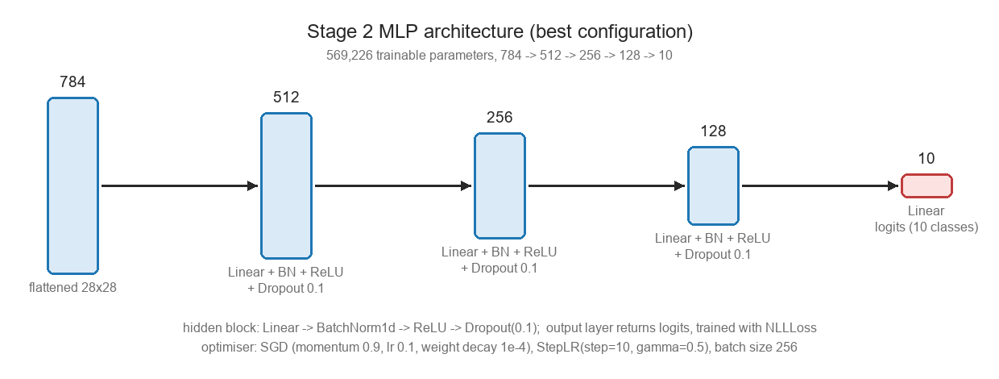
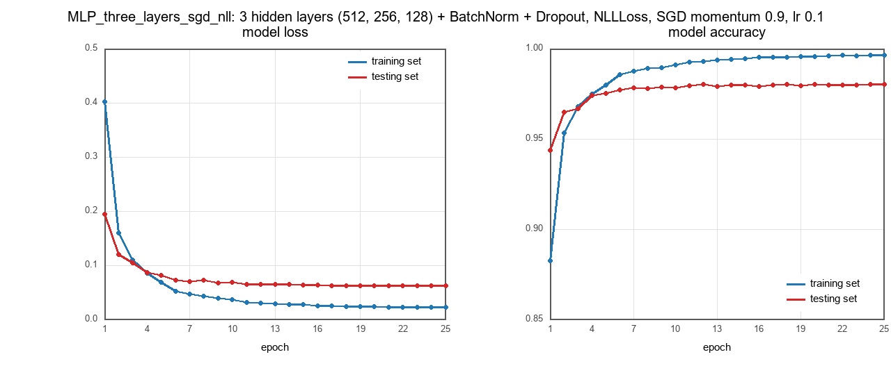

# ECS 170 Course Project &mdash; Stage 2: Handwritten Digit Classification

Stage 2 of the ECS 170 (Artificial Intelligence) course project: classify 28&times;28 handwritten
digit images with a fully-connected neural network, and compare it with two classical models
(decision tree and SVM) on the same pre-partitioned data set.

The Stage 2 data set has **60,000 training** and **10,000 testing** examples, 784 pixel features
(values in `[0, 255]`, normalised to `[0, 1]`) and 10 balanced classes (`0`-`9`).

## Results (10,000 test examples)

| Model | Accuracy | Precision (w) | Recall (w) | F1 (w) | F1 (macro) |
| --- | --- | --- | --- | --- | --- |
| Decision tree (CART, gini) | 0.8757 | 0.8759 | 0.8757 | 0.8757 | 0.8743 |
| SVM (RBF, 8,000 examples) | 0.9617 | 0.9617 | 0.9617 | 0.9616 | 0.9613 |
| MLP baseline (`784-128-10`) | 0.9766 | 0.9766 | 0.9766 | 0.9766 | 0.9764 |
| MLP deeper (`784-512-256-10`, BN + dropout) | 0.9782 | 0.9782 | 0.9782 | 0.9782 | 0.9780 |
| **MLP best** (`784-512-256-128-10`, BN + dropout, NLLLoss + SGD) | **0.9801** | 0.9801 | 0.9801 | 0.9801 | 0.9800 |

The `(w)` columns are support-weighted averages; macro and micro averages are computed as well and
stored with every result (micro equals the accuracy for single-label multi-class problems).

**Architecture of the best model** (569,226 parameters):



**Training convergence** (25 epochs, blue = training split, red = test split):



## Repository layout

```
local_code/
  base_class/            abstract classes of the course template (dataset, method, evaluate, ...)
  stage_1_code/          Stage 1 implementation (kept for reference)
  stage_2_code/          Stage 2 implementation
    Dataset_Loader.py    reads train.csv / test.csv, normalises the pixels
    Method_MLP.py        configurable MLP: depth, width, dropout, BN, loss, optimiser, scheduler
    Method_DT.py         decision tree
    Method_SVM.py        support vector machine
    Evaluate_Metrics.py  accuracy + weighted / macro / micro precision, recall, F1, confusion matrix
    Setting_Train_Test.py  train -> test -> save pipeline for pre-partitioned data (no CV)
    Plot_Learning_Curve.py  loss / accuracy curves (matplotlib if installed, otherwise Pillow)
    Result_Saver.py, Result_Loader.py, Evaluate_Accuracy.py
script/
  stage_1_script/        Stage 1 scripts
  stage_2_script/
    script_mlp.py        runs the three MLP configurations, saves results and curves
    script_decision_tree.py
    script_svm.py
    script_load_result.py  reloads the saved results and prints a comparison table
    run_all.py           runs the four scripts above in order with one command
result/
  stage_1_result/
  stage_2_result/        pickled predictions + metrics, plots/ holds the PNG figures and CSV histories
```

## Data set

Download the Stage 2 data (it ships as a folder with `train.csv` and `test.csv`) and point the code
at it either by editing `DEFAULT_STAGE2_DATA_FOLDER` in the scripts / `Dataset_Loader.py`, or by
setting an environment variable:

```bash
# Linux / macOS
export STAGE2_DATA_FOLDER=/path/to/stage_2_data
# Windows (cmd)
set STAGE2_DATA_FOLDER=D:\path\to\stage_2_data
# Windows (PowerShell)
$env:STAGE2_DATA_FOLDER = 'D:\path\to\stage_2_data'
```

Each CSV line is `label, pixel_1, ..., pixel_784`.

## Setup

Requires Python 3.10+ and the packages in `requirements.txt`:

```bash
pip install -r requirements.txt
```

Any PyTorch build works; a CUDA or ROCm build is used automatically when it is available, otherwise
the code falls back to the CPU (`STAGE2_DEVICE=cpu` forces the CPU).

## Running the experiments

```bash
# everything: MLP experiments, decision tree, SVM, summary table
python script/stage_2_script/run_all.py

# or one step at a time
python script/stage_2_script/script_mlp.py
python script/stage_2_script/script_decision_tree.py
python script/stage_2_script/script_svm.py
python script/stage_2_script/script_load_result.py
```

Outputs go to `result/stage_2_result/` (pickled predictions and metrics) and
`result/stage_2_result/plots/` (one PNG and one CSV history per MLP configuration).

A quick smoke test on a subset of the data, to check that everything runs:

```bash
STAGE2_TRAIN_LIMIT=2000 STAGE2_TEST_LIMIT=1000 STAGE2_EPOCHS=2 python script/stage_2_script/script_mlp.py
```

### Environment variables

| Variable | Meaning |
| --- | --- |
| `STAGE2_DATA_FOLDER` | folder that contains `train.csv` and `test.csv` |
| `STAGE2_TRAIN_LIMIT` / `STAGE2_TEST_LIMIT` | keep only that many examples (`0` = full data set) |
| `STAGE2_EPOCHS` | override the number of epochs of **every** MLP configuration |
| `STAGE2_DEVICE` | `cpu` forces the CPU, `cuda` forces the GPU, empty = automatic |

## Implementation notes

* The MLP returns **logits** and `NLLLoss` / `CrossEntropyLoss` apply log-softmax internally; the
  Stage 1 template applied a softmax layer *and* `CrossEntropyLoss`, which double-normalised the
  outputs and slowed the training down.
* The Stage 2 data set is already split, so `Setting_Train_Test` neither splits nor cross-validates.
  The test split is only used for evaluation (and for the test curves of the convergence plot).
* Because the problem is multi-class, precision, recall and F1 are reported in their weighted, macro
  and micro variants instead of the binary versions.
* The plots are generated with matplotlib when it is installed; otherwise a small Pillow renderer
  draws the same two-panel figure so that the pipeline still produces a figure on a minimal install.
* Best model: 25 epochs, about 16 s of training on an AMD Radeon RX 9070 XT (ROCm), seed 1.

## Acknowledgement

The project skeleton (`local_code/base_class`, the Stage 1 code and the script layout) is the course
template by Prof. Jiawei Zhang; the Stage 2 implementation in `local_code/stage_2_code` and
`script/stage_2_script` is our own work.
