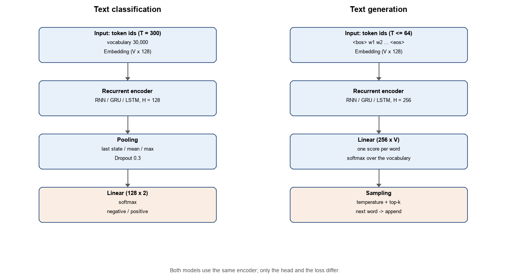
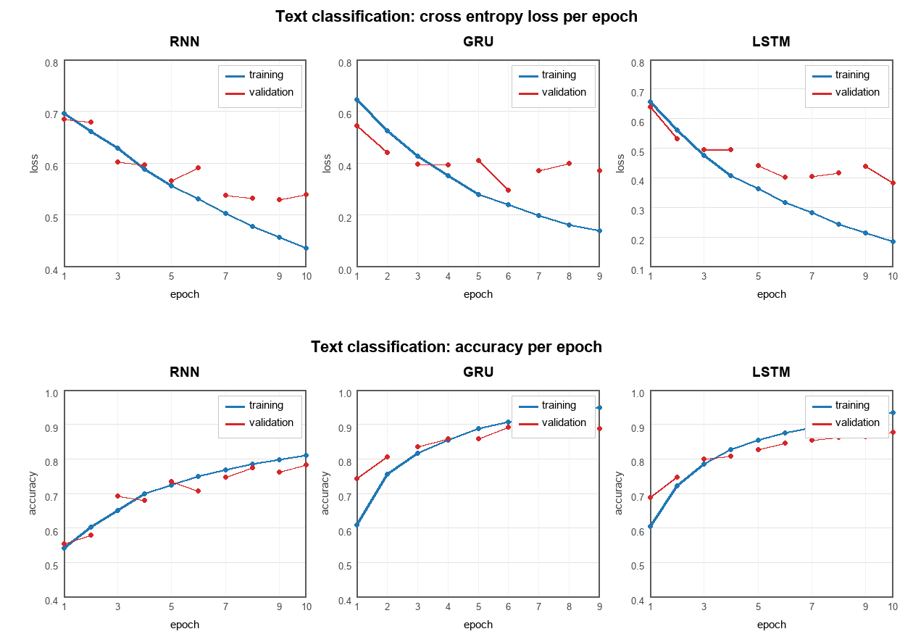
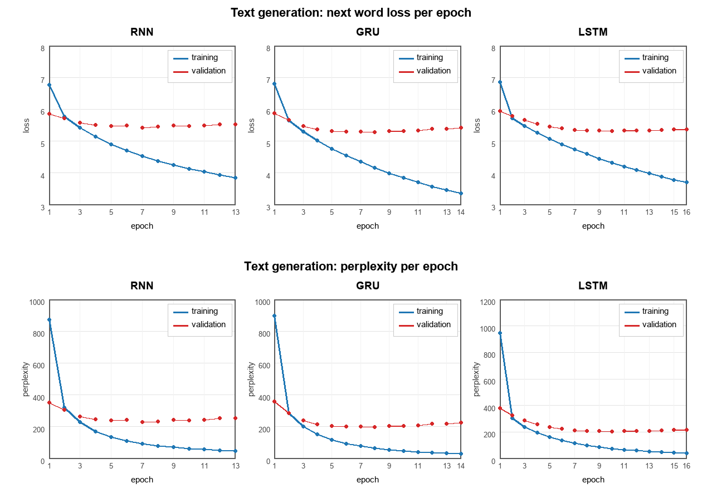
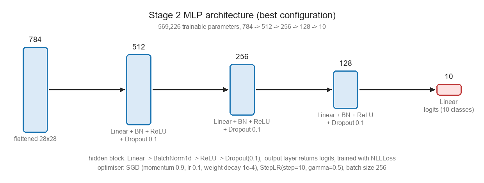
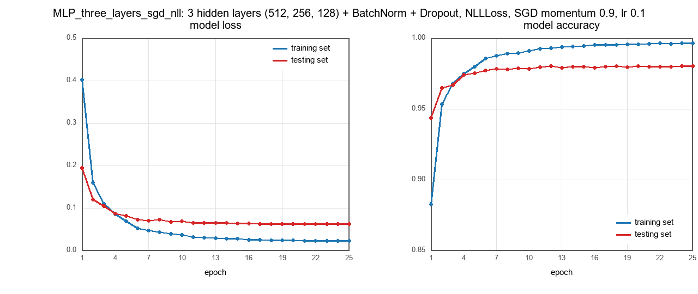

# ECS 170 Course Project &mdash; Stages 2 and 4

This repository holds two stages of the ECS 170 (Artificial Intelligence) course project, both
built inside the same course template (`local_code/base_class` + one `local_code/stage_X_code`
package + one `script/stage_X_script` folder per stage):

* **Stage 2** &mdash; handwritten digit classification with a fully-connected network, compared with
  a decision tree and an SVM.
* **Stage 4** &mdash; recurrent networks on text: sentiment classification of movie reviews and
  word-level generation of jokes, with RNN, GRU and LSTM cells and an ablation study.

---

# Stage 4: Text Classification and Text Generation

Two tasks share one implementation: an embedding layer, a **hand-written recurrent encoder** (an
explicit loop over the time steps that applies `nn.RNNCell`, `nn.GRUCell` or `nn.LSTMCell`) and a
task-specific head. The encoder is not the fused `torch.nn.RNN/GRU/LSTM` layer, so the recurrence,
the padding mask and the bidirectional pass are all visible in
`local_code/stage_4_code/Recurrent_Network.py`.

* **Text classification** &mdash; 25,000 IMDb training reviews and 25,000 testing reviews, binary
  positive/negative sentiment. Vocabulary 30,000 words, reviews truncated to 300 tokens, 10% of the
  training split held out for early stopping.
* **Text generation** &mdash; 1,622 single-line jokes (vocabulary 4,761 words, 17.7 tokens per joke
  on average). Each joke is wrapped into `<bos> ... <eos>` and the model is trained to predict the
  next word, so a joke can be sampled from its first three words. 1,460 jokes are used for training
  and 162 for validation.

## Results &mdash; text classification (25,000 testing reviews)

| Unit | Accuracy | Precision | Recall | F1 | F1 (macro) | Parameters | Time |
| --- | --- | --- | --- | --- | --- | --- | --- |
| RNN (tanh) | 0.7738 | 0.7342 | 0.8584 | 0.7914 | 0.7722 | 3,873,282 | 490 s |
| **GRU** | **0.8736** | 0.8659 | 0.8842 | **0.8750** | **0.8736** | 3,939,330 | 425 s |
| LSTM | 0.8589 | 0.8582 | 0.8598 | 0.8590 | 0.8589 | 3,972,354 | 500 s |

Identical data, seed, optimiser and epoch budget; only the recurrent cell changes. The gated units
keep a usable state over the 300 time steps, the vanilla RNN does not.

## Results &mdash; text generation (validation split, 162 held-out jokes)

| Unit | Perplexity | Next-word acc. | Nearest LCS | Distinct-2 | Finished | Time |
| --- | --- | --- | --- | --- | --- | --- |
| RNN | 228.69 | 4.83% | 0.4234 | 0.9412 | 100% | 26 s |
| **GRU** | **199.06** | **5.31%** | 0.3767 | 0.8875 | 100% | 13 s |
| LSTM | 206.17 | 5.13% | 0.3736 | 0.9324 | 100% | 15 s |
| LSTM, 2 layers | 244.26 | 5.03% | 0.3928 | 0.9244 | 86% | 36 s |

"Nearest LCS" is the longest-common-subsequence overlap between a generated joke and the closest
training joke; "distinct-2" is the ratio of distinct word bigrams; "finished" is the fraction of
samples that reach `<eos>` instead of the token budget.

**Architecture of the two models**:



**Training convergence** (blue = training split, red = validation split):





## Running the Stage 4 experiments

```bash
# all classifiers of Sections 3.6 and 3.7 (RNN / GRU / LSTM + three ablation variants)
python -m script.stage_4_script.script_classification --models rnn,gru,lstm --epochs 10 --batch-size 128
python -m script.stage_4_script.script_classification --models gru_bidirectional,lstm_2layer,gru_meanpool \
    --epochs 10 --batch-size 128 --output-folder result/stage_4_result/ablation

# the joke generators (RNN / GRU / LSTM / 2-layer LSTM), sampling seven three-word prompts
python -m script.stage_4_script.script_generation

# the figures of this README and of the report
python -m script.stage_4_script.make_figures
```

Outputs go to `result/stage_4_result/{classification,ablation,generation}/` (one pickled result per
configuration plus a `summary.json`) and to `result/stage_4_result/figures/`.

### Stage 4 environment variables

| Variable | Meaning |
| --- | --- |
| `STAGE4_DATA_FOLDER` | root of the two Stage 4 data sets |
| `MIOPEN_CUSTOM_CACHE_DIR`, `MIOPEN_USER_DB_PATH` | writable MIOpen kernel cache (AMD GPUs only) |
| `--device cpu` | forces the CPU on any of the Stage 4 scripts |

On an AMD GPU the ROCm build of PyTorch needs a writable MIOpen cache inside the workspace,
otherwise the first recurrent kernel fails with `MIOpen Error: create_directories: Access is
denied`. The run commands above already set it:

```powershell
$env:MIOPEN_CUSTOM_CACHE_DIR = "$PWD\result\stage_4_result\miopen"
$env:MIOPEN_USER_DB_PATH    = $env:MIOPEN_CUSTOM_CACHE_DIR
```

---

# Stage 2: Handwritten Digit Classification

Stage 2 of the ECS 170 course project: classify 28&times;28 handwritten digit images with a
fully-connected neural network, and compare it with two classical models (decision tree and SVM) on
the same pre-partitioned data set.

The Stage 2 data set has **60,000 training** and **10,000 testing** examples, 784 pixel features
(values in `[0, 255]`, normalised to `[0, 1]`) and 10 balanced classes (`0`-`9`).

## Results (10,000 test examples)

| Model | Accuracy | Precision (w) | Recall (w) | F1 (w) | F1 (macro) |
| --- | --- | --- | --- | --- | --- |
| Decision tree (CART, gini) | 0.8757 | 0.8759 | 0.8757 | 0.8757 | 0.8743 |
| SVM (RBF, 8,000 examples) | 0.9617 | 0.9617 | 0.9617 | 0.9616 | 0.9613 |
| MLP baseline (`784-128-10`) | 0.9766 | 0.9766 | 0.9766 | 0.9766 | 0.9764 |
| MLP deeper (`784-512-256-10`, BN + dropout) | 0.9782 | 0.9782 | 0.9782 | 0.9782 | 0.9780 |
| **MLP best** (`784-512-256-128-10`, BN + dropout, NLLLoss + SGD) | **0.9801** | 0.9801 | 0.9801 | 0.9801 | 0.9800 |

The `(w)` columns are support-weighted averages; macro and micro averages are computed as well and
stored with every result (micro equals the accuracy for single-label multi-class problems).

**Architecture of the best model** (569,226 parameters):



**Training convergence** (25 epochs, blue = training split, red = test split):



## Running the Stage 2 experiments

```bash
# everything: MLP experiments, decision tree, SVM, summary table
python script/stage_2_script/run_all.py

# or one step at a time
python script/stage_2_script/script_mlp.py
python script/stage_2_script/script_decision_tree.py
python script/stage_2_script/script_svm.py
python script/stage_2_script/script_load_result.py
```

Outputs go to `result/stage_2_result/` (pickled predictions and metrics) and
`result/stage_2_result/plots/` (one PNG and one CSV history per MLP configuration).

A quick smoke test on a subset of the data, to check that everything runs:

```bash
STAGE2_TRAIN_LIMIT=2000 STAGE2_TEST_LIMIT=1000 STAGE2_EPOCHS=2 python script/stage_2_script/script_mlp.py
```

### Stage 2 environment variables

| Variable | Meaning |
| --- | --- |
| `STAGE2_DATA_FOLDER` | folder that contains `train.csv` and `test.csv` |
| `STAGE2_TRAIN_LIMIT` / `STAGE2_TEST_LIMIT` | keep only that many examples (`0` = full data set) |
| `STAGE2_EPOCHS` | override the number of epochs of **every** MLP configuration |
| `STAGE2_DEVICE` | `cpu` forces the CPU, `cuda` forces the GPU, empty = automatic |

---

# Repository layout

```
local_code/
  base_class/            abstract classes of the course template (dataset, method, evaluate, ...)
  stage_1_code/          Stage 1 implementation (kept for reference)
  stage_2_code/          Stage 2 implementation
    Dataset_Loader.py    reads train.csv / test.csv, normalises the pixels
    Method_MLP.py        configurable MLP: depth, width, dropout, BN, loss, optimiser, scheduler
    Method_DT.py         decision tree
    Method_SVM.py        support vector machine
    Evaluate_Metrics.py  accuracy + weighted / macro / micro precision, recall, F1, confusion matrix
    Setting_Train_Test.py  train -> test -> save pipeline for pre-partitioned data (no CV)
    Plot_Learning_Curve.py  loss / accuracy curves (matplotlib if installed, otherwise Pillow)
    Result_Saver.py, Result_Loader.py, Evaluate_Accuracy.py
  stage_4_code/          Stage 4 implementation
    Text_Utils.py        cleaning, tokenisation, vocabulary, padding
    Dataset_Loader_Classification.py  IMDb reviews -> padded token ids, validation split
    Dataset_Loader_Generation.py      jokes -> <bos> ... <eos> sequences, prompt encoder
    Recurrent_Network.py  hand-written RNN / GRU / LSTM encoder (RNNCell, GRUCell, LSTMCell)
    Method_RNN.py        sentiment classifier: embedding -> encoder -> pooling -> linear
    Method_RNN_Generation.py  next-word language model + temperature / top-k sampling
    Evaluate_Metrics.py  accuracy, precision, recall, F1, confusion matrix
    Evaluate_Generation.py  perplexity, overlap and repetition metrics of the generated jokes
    Plot_Figure.py, Plot_Learning_Curve.py  Pillow-based charts and learning curves
    Setting_Stage_4.py   train -> evaluate -> save pipelines of the two tasks
    Result_Saver.py, Result_Loader.py
script/
  stage_1_script/        Stage 1 scripts
  stage_2_script/        script_mlp.py, script_decision_tree.py, script_svm.py,
                         script_load_result.py, run_all.py
  stage_4_script/        script_classification.py (3 units + 3 ablation variants)
                         script_generation.py (4 generators + 7 sampling prompts)
                         make_figures.py, build_report.py, run_all.py
result/
  stage_1_result/
  stage_2_result/        pickled predictions + metrics, plots/ holds the PNG figures and CSV histories
  stage_4_result/        classification/, ablation/, generation/, figures/, cache/, miopen/
```

# Data sets

**Stage 2** &mdash; download the digit data (a folder with `train.csv` and `test.csv`) and point the
code at it either by editing `DEFAULT_STAGE2_DATA_FOLDER` in the scripts / `Dataset_Loader.py`, or
by setting `STAGE2_DATA_FOLDER`. Each CSV line is `label, pixel_1, ..., pixel_784`.

**Stage 4** &mdash; the two text folders (`text_classification/` with `train/` and `test/` and one
`.txt` per review, and `text_generation/data`, a two-column CSV of jokes) are read from
`D:\dl\Compressed\stage_4_dataa` by default; set `STAGE4_DATA_FOLDER` to move them. The tokenised
IMDb reviews are cached in `result/stage_4_result/cache/` so the 50,000 files are only parsed once.

# Setup

Requires Python 3.10+ and the packages in `requirements.txt`:

```bash
pip install -r requirements.txt
```

Any PyTorch build works; a CUDA or ROCm build is used automatically when it is available, otherwise
the code falls back to the CPU. The figures are drawn with Pillow, so matplotlib is optional.

# Implementation notes

* The MLP returns **logits** and `NLLLoss` / `CrossEntropyLoss` apply log-softmax internally; the
  Stage 1 template applied a softmax layer *and* `CrossEntropyLoss`, which double-normalised the
  outputs and slowed the training down.
* The Stage 2 data set is already split, so `Setting_Train_Test` neither splits nor cross-validates.
  The test split is only used for evaluation (and for the test curves of the convergence plot).
* Because the Stage 2 problem is multi-class, precision, recall and F1 are reported in their
  weighted, macro and micro variants instead of the binary versions.
* The Stage 4 encoder applies one `RNNCell`/`GRUCell`/`LSTMCell` per time step. The fused
  `nn.RNN` layers were tried first, but on an AMD GPU every distinct padded batch shape triggers a
  MIOpen kernel search of several seconds (`MIOpen Error: create_directories: Access is denied`
  unless the cache is redirected into the workspace), which made the first epoch of IMDb take
  114 s instead of 47 s and repeated the search in every new process; the cell loop keeps the
  matrix shapes constant, avoids the search, and makes the recurrence explicit.
* Padding is handled by a mask that freezes the hidden state once the real tokens of a review are
  exhausted, so padded positions never change the state (this replaces
  `pack_padded_sequence`, which the fused layers needed).
* The checkpoint that is kept is the epoch with the best **validation accuracy** (the validation
  loss breaks ties); the official testing set is only evaluated once, at the end.
* Stage 4 sampling uses temperature 0.9, top-k 30 and a repetition penalty of 1.1; the seven prompts
  are four openings taken from the corpus and three invented ones.
* Best Stage 2 model: 25 epochs, about 16 s of training on an AMD Radeon RX 9070 XT (ROCm), seed 1.
  Best Stage 4 classifiers: 10 epochs, 7-8 minutes each on the same GPU.

## Acknowledgement

The project skeleton (`local_code/base_class`, the Stage 1 code and the script layout) is the course
template by Prof. Jiawei Zhang; the Stage 2 implementation in `local_code/stage_2_code` /
`script/stage_2_script` and the Stage 4 implementation in `local_code/stage_4_code` /
`script/stage_4_script` are our own work.
